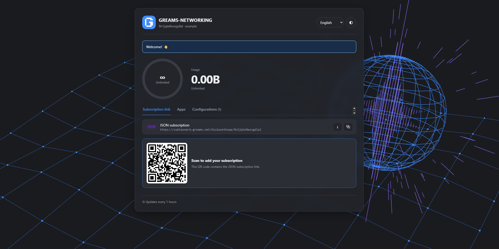

# Custom Subscription Page

A standalone, responsive subscription page template for 3x-ui.



[English](#english) · [Русский](#русский)

---

## English

This custom HTML template brings subscription usage, a JSON subscription link, app import links, and individual configuration links together in one page.

### Features

- Usage overview with an unlimited-plan display.
- Light and dark themes, saved in the visitor's browser.
- Animated Vanta Globe background.
- Interface languages: English, Russian, Spanish, French, German, Portuguese, and Chinese. The selected language is saved in the browser.
- JSON subscription link with copy, raw JSON open, and QR code.
- Android/iOS selector and one-tap Happ and Incy import links.
- Configuration links with protocol and transport/security labels, copy controls, and QR dialogs.
- Optional announcement, automatic update interval, support link, and responsive mobile layout.

### Compared with the built-in subscription page

The built-in page is a React frontend shipped with 3x-ui. This project is a separate HTML template selected through **Sub Theme Directory**, with its own styling, animated background, and language selector. It uses subscription data and links provided by 3x-ui; it does not replace the panel or subscription server and does not create or modify client configurations.

### Install in 3x-ui

1. Copy this folder to any location on the server where the 3x-ui service account can read the folder and files. It does **not** need to be under `/etc/`. For example:

   ```text
   /home/myuser/custom_sub_page/
   ```

2. In the panel, open **Settings → Subscription → Information**.
3. Enter the folder's absolute path in **Sub Theme Directory** (for example, `/home/myuser/custom_sub_page/`).
4. Make sure the 3x-ui service account has read and directory-traverse permission for the folder and its files.
5. Save the settings and open a subscriber's subscription page.

The folder must contain `index.html`. The panel renders the template using subscription values supplied by 3x-ui, including `.subTitle`, `.subUrl`, `.subJsonUrl`, `.links`, `.emails`, `.announce`, and `.subSupportUrl`. Opening `index.html` directly as a static file will not render those template values.

### Files

| File | Purpose |
| --- | --- |
| `index.html` | Complete HTML template, styles, translations, and page behavior |
| `screenshot.png` | Preview of the subscription page |
| `LICENSE` | License for this custom page |
| `QRCODE-LICENSE.txt` | QRCode library license notice |
| `THREE-LICENSE.txt` | Three.js license notice |
| `VANTA-LICENSE.txt` | Vanta license notice |

### Privacy and dependencies

- Theme and language choices are stored in `localStorage` on the visitor's device.
- Subscription links and QR codes contain access credentials. Treat them as private; anyone who obtains a link may be able to use the subscription.
- QRCode, Three.js, and Vanta code is bundled in `index.html`; no build step or external JavaScript files are required.

### License

This custom page is provided under the [MIT License](LICENSE). Third-party notices are included in the `*-LICENSE.txt` files.

---

## Русский

Самостоятельный адаптивный HTML-шаблон страницы подписки для 3x-ui. На одной странице собраны данные об использовании трафика, JSON-ссылка подписки, ссылки для импорта в приложения и отдельные ссылки конфигураций.

### Возможности

- Обзор использования трафика и отображение безлимитного тарифа.
- Светлая и тёмная темы; выбор сохраняется в браузере пользователя.
- Анимированный фон Vanta Globe.
- Языки интерфейса: английский, русский, испанский, французский, немецкий, португальский и китайский. Выбранный язык сохраняется в браузере.
- JSON-ссылка подписки с копированием, открытием исходного JSON и QR-кодом.
- Выбор Android/iOS и быстрый импорт в Happ и Incy.
- Ссылки конфигураций с обозначениями протокола, транспорта и защиты, кнопками копирования и QR-диалогами.
- Необязательное объявление, интервал автообновления, ссылка поддержки и адаптивная мобильная версия.

### Отличия от встроенной страницы подписки

Встроенная страница — это React-интерфейс, который поставляется вместе с 3x-ui. Этот проект — отдельный HTML-шаблон, который подключается через настройку **Sub Theme Directory**, со своим оформлением, анимированным фоном и переключателем языков. Он использует данные и ссылки подписки, предоставляемые 3x-ui, но не заменяет панель или сервер подписок и не создаёт и не изменяет конфигурации клиентов.

### Установка в 3x-ui

1. Скопируйте эту папку в любое место на сервере, откуда служебная учётная запись 3x-ui сможет читать папку и файлы. Размещать её в `/etc/` **не обязательно**. Например:

   ```text
   /home/myuser/custom_sub_page/
   ```

2. В панели откройте **Settings → Subscription → Information**.
3. Укажите абсолютный путь к папке в поле **Sub Theme Directory** (например, `/home/myuser/custom_sub_page/`).
4. Убедитесь, что у служебной учётной записи 3x-ui есть права чтения файлов и прохода по каталогам.
5. Сохраните настройки и откройте страницу подписки клиента.

В папке должен находиться `index.html`. Панель обрабатывает шаблон с данными подписки 3x-ui, например `.subTitle`, `.subUrl`, `.subJsonUrl`, `.links`, `.emails`, `.announce` и `.subSupportUrl`. Если открыть `index.html` напрямую как статический файл, значения шаблона обработаны не будут.

### Файлы

| Файл | Назначение |
| --- | --- |
| `index.html` | HTML-шаблон, стили, переводы и логика страницы |
| `screenshot.png` | Скриншот страницы подписки |
| `LICENSE` | Лицензия этого шаблона |
| `QRCODE-LICENSE.txt` | Уведомление о лицензии библиотеки QRCode |
| `THREE-LICENSE.txt` | Уведомление о лицензии Three.js |
| `VANTA-LICENSE.txt` | Уведомление о лицензии Vanta |

### Конфиденциальность и зависимости

- Выбор темы и языка хранится в `localStorage` браузера пользователя.
- Ссылки подписки и QR-коды содержат данные доступа. Храните их в секрете: обладатель ссылки может получить доступ к подписке.
- Код QRCode, Three.js и Vanta включён в `index.html`; сборка и внешние файлы JavaScript не требуются.

### Лицензия

Шаблон распространяется по [лицензии MIT](LICENSE). Уведомления о сторонних компонентах находятся в файлах `*-LICENSE.txt`.